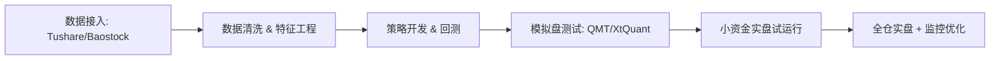

# 📈涨停天梯

## Polymarket

### AI充当你的全栈量化开发助理，解决“脏活累活”和“策略灵感”。

### Read Your Mind: Proven Habits for Success from the World’s Greatest Mentalist and an Elite Endurance Athlete


## 量化交易的本质与落点

量化投资的核心，本质上是**利用数学模型和计算机技术，在海量数据中寻找大概率获胜的规律，并严格执行交易**。它赚的不是“内幕消息”或“主观直觉”的钱，而是**概率、纪律、速度和规模**的钱。

根据你提到的四个维度，量化投资赚的钱可以详细拆解为以下几类：

------

### 1. 趋势跟踪的钱 (Trend Following)

**核心逻辑：** 追涨杀跌的理性版。基于“价格包含一切信息”和“人类心理的惯性（贪婪与恐惧）”。

- **赚的是什么：** 赚的是**市场非理性情绪延续**和**宏观经济周期**的钱。当市场形成共识时，趋势会自我强化。量化模型通过均线、动量（Momentum）、通道突破等指标，在趋势确立时上车，在趋势反转时下车。
- **特点：** 胜率通常不高（可能只有 30%-40%），但**盈亏比极高**。靠几次大趋势覆盖多次小止损。
- **典型策略：** CTA（商品交易顾问）策略、动量策略、双均线策略。
- **痛点：** 在震荡市中会被反复“打脸”（Whipsaw），需要极强的资金管理来熬过回撤期。

### 2. 均值回归/震荡的钱 (Mean Reversion)

**核心逻辑：** 物极必反。基于“价格围绕价值波动”和“过度反应后的修正”。

- **赚的是什么：** 赚的是**市场过度反应**和**流动性溢价**的钱。当价格因短期恐慌或狂热偏离合理价值过远时，量化模型会反向操作，等待价格回归。
- **特点：** 胜率较高（可能 60%-70%），但**盈亏比相对较低**。赚的是“小钱、快钱”，像推土机前捡硬币，偶尔遇到黑天鹅会面临巨大风险。
- **典型策略：** 统计套利（配对交易）、布林带策略、网格交易、做市策略（Market Making）。
- **痛点：** 害怕单边极端行情（如股灾或逼空），一旦趋势不回头，亏损会迅速放大。

### 3. 套利的钱 (Arbitrage)

**核心逻辑：** 一价定律。基于“相同资产在不同市场/形式下价格应一致”。

- **赚的是什么：** 赚的是**市场定价错误（Mispricing）和摩擦成本**的钱。这是量化中最接近“无风险收益”的部分，但机会正在迅速减少。
- 细分类型：
  - **期现套利：** 期货价格与现货价格基差过大时，买低卖高。
  - **跨期套利：** 同一品种不同月份合约价差异常。
  - **跨品种套利：** 如螺纹钢与热卷、豆油与棕榈油的价差回归。
  - **ETF套利：** ETF净值与交易价格偏离时的瞬间买卖。
- **特点：** 风险极低，收益稳定，但**资金容量有限**，且对硬件和通道要求极高。
- **痛点：** 随着参与者增多，价差会迅速被抹平，现在更多是赚“执行速度”的钱。

### 4. 高频/微观结构的钱 (High Frequency / HFT)

**核心逻辑：** 天下武功，唯快不破。基于**订单流（Order Flow）和微观市场结构**。

- 赚的是什么：
  - **流动性提供：** 赚买卖价差（Bid-Ask Spread）和交易所返佣。
  - **信息延迟：** 赚比竞争对手快几微秒看到新闻或大单的钱（Latency Arbitrage）。
  - **订单簿不平衡：** 通过盘口挂单情况，预测未来几秒到几分钟的价格微动。
- **特点：** 持仓时间极短（秒级甚至毫秒级），日换手率极高，单笔利润极薄，靠**海量交易次数**累积利润。
- **痛点：** **技术军备竞赛**。需要投入巨资在机房托管（Co-location）、FPGA硬件、专线网络上。一旦技术落后，就是“待宰的羔羊”。

------

### 5. 补充：量化还在赚什么钱？（非常重要）

除了上述四种，现代量化（尤其是股票量化）还有两个巨大的利润来源：

#### A. 多因子选股的钱 (Factor Investing / Alpha)

- **赚的是什么：** 赚的是**承担特定风险暴露**的钱，以及**挖掘无效市场定价**的钱。
- **解释：** 比如“小市值因子”、“高股息因子”、“低波动因子”。长期来看，小公司比大公司风险大，所以给高收益，这是风险补偿。但在A股这种散户多、机构博弈不充分的市场，量化通过挖掘成千上万个非线性因子（如分析师预期差、另类数据、供应链关系），能赚到纯粹的 **Alpha（超额收益）**。
- **本质：** 用机器的广度（覆盖全市场5000只股票）和深度（几百个因子）去收割人类认知局限的钱。

#### B. 纪律与风控的钱 (Behavioral & Risk Management)

- **赚的是什么：** 赚的是**克服人性弱点**的钱。
- **解释：** 人类会贪婪、恐惧、犹豫、报复性交易。量化没有情绪，止损坚决，仓位管理严格。在同样的行情下，量化往往能比主观交易多赚 10%-20%，少亏 10%-20%，这部分就是“纪律溢价”。

------

### 总结：量化投资的“食物链”

如果把市场比作一个生态系统：

1. **高频/做市商**：在食物链顶端，赚**速度和流动性**的钱（捡地上的芝麻，但捡得极快）。
2. **套利/统计套利**：赚**定价错误**的钱（修补市场的漏洞）。
3. **趋势/CTA**：赚**宏观周期和人性惯性**的钱（在大风大浪中冲浪）。
4. **多因子/基本面量化**：赚**信息处理效率和风险溢价**的钱（在海量数据中淘金）。

**一句话概括：** 量化投资赚的是**市场无效性（Inefficiency）的钱。无论是趋势的惯性、震荡的过度反应、套利的价差，还是高频的延迟，本质上都是市场在某一时刻、某一维度上不够聪明**或**反应不够快**，量化模型抓住了这个瞬间，将其转化为利润。

**随着市场越来越有效，赚“简单钱”的时代正在结束，现在的量化更多是在赚“复杂钱”和“苦力钱”（拼算力、拼数据、拼执行）。**

------

想深入了解哪个方向？

1. A股多因子选股的具体因子和实战逻辑
2. CTA趋势策略的完整框架和回测方法
3. 量化入门的学习路径和工具推荐

量化投资的应用领域非常广泛，除了你提到的股票、期货、ETF和期权之外，还包括宏观资产配置、另类数据投资以及多策略组合等。根据底层资产和交易标的的不同，量化投资主要可以划分为以下几大类：

### 1. 股票量化投资

这是量化投资最核心的领域之一，主要利用海量数据和算法模型在全市场中寻找投资机会。其核心环节包括数据收集与清洗、因子构建（如基本面、技术面、高频因子等）、因子回测、组合优化以及交易执行。常见的策略包括：

- **基本面量化：** 通过处理财务报表等公开信息，挖掘低估值、高成长等规律，持仓周期较长。
- **统计套利（价量模型）：** 运用价格和交易量数据，预测个股中短期的相对走势，寻找短期偏离合理价格的股票进行多空操作。
- **量化对冲：** 在持有股票多头组合的同时，做空股指期货等衍生品，对冲掉市场的系统性风险（Beta），只赚取基金经理选股带来的超额收益（Alpha）。

### 2. 期货量化投资（CTA策略）

期货市场支持T+0交易和双向交易（可做多做空），为量化策略提供了极大的便利。常见的期货量化策略包括：

- **趋势跟踪：** 通过技术分析（如移动平均线、RSI等）或基本面数据，识别并跟随宏观或微观市场的价格趋势，在牛熊市或商品周期中表现突出。
- **均值回归：** 认为期货价格会围绕其长期均值波动，当价格偏离均值过大时进行反向交易。
- **期货套利：** 利用不同市场、不同月份或不同品种（如螺纹钢与热卷）之间的价格差异进行跨期、跨市场或跨品种套利。

### 3. ETF量化投资

ETF（交易所交易基金）因其交易灵活、成本低廉、品种丰富（涵盖股票、债券、商品等），成为量化资产配置的重要工具。相关策略包括：

- **指数增强策略：** 在紧密跟踪标的指数（如沪深300、中证A500）的基础上，利用量化多因子模型对成分股进行优化或在全市场优选股票，力求获取超越指数的超额收益。
- **ETF套利：** 当ETF的市场交易价格与其实际净值出现较大偏差时，通过一二级市场瞬间买卖进行折溢价套利。
- **资产配置与轮动：** 利用量化模型（如风险平价、美林时钟）在不同类型的ETF（如股、债、商品）之间进行动态配置和波段交易。

### 4. 期权量化投资

期权具有非线性的收益结构和多维度的风险敞口，其量化交易高度依赖数学模型（如Black-Scholes模型）和计算机算法。主要策略包括：

- **波动率交易：** 期权价格与标的资产的波动率密切相关。量化模型通过分析历史波动率和隐含波动率的差异，预测波动率变化，从而决定买入或卖出期权。
- **方向性策略：** 结合量化指标判断标的资产价格的方向，买入看涨或看跌期权。
- **期权套利与做市：** 利用不同行权价、不同到期日的期权合约之间的价格偏离进行统计套利，或通过同时提供买卖报价赚取买卖价差。

### 5. 全球宏观量化投资

除了单一资产类别，量化投资还广泛应用于跨资产类别的宏观配置。

- **宏观策略：** 基于对全球宏观经济指标、政策变化和地缘政治的量化分析，在股票、债券、外汇、大宗商品等多个市场之间进行资产配置。这类策略高度依赖管理人对宏观信号的前瞻解读和量化模型的结合，分为量化宏观和主观宏观。

### 6. 另类数据与AI量化投资

随着技术的发展，量化投资的数据源和算法也在不断进化。

- **另类数据驱动：** 利用非传统数据源（如社交媒体情绪、卫星图像、信用卡消费记录等）来预测市场走势，弥补传统财务数据的滞后性。
- **AI与机器学习：** 利用深度学习、强化学习等人工智能算法，处理海量非线性数据，自动挖掘传统方法难以捕捉的市场微观规律和交易模式。

### 7. 多策略组合投资

为了应对复杂多变的市场环境，许多量化机构会采用多策略投资。

- **多策略融合：** 将趋势跟踪、统计套利、基本面量化等多种策略结合在一起。当某一种策略在特定市场环境下失效时，其他策略可以提供收益缓冲，从而在不同市场周期中保持相对稳定的回报。

------

想深入了解一下哪类策略的实战细节？

1. A股多因子选股的具体因子和组合优化方法
2. CTA趋势策略的完整框架和回测方法
3. 期权波动率交易的建模和实战逻辑


- AI编程：Cursor / Trae / Lingma
- 环境部署：Anaconda、VSCode、Python
- 数据接入：Tushare / Baostock
- 实盘预告：QMT / XtQuant

你问的是：“**数据接入和实盘预告应该怎么使用？**”
这实际上是在问：**在量化交易或金融数据分析场景中，如何正确连接历史/实时数据（数据接入），以及如何准备或模拟真实交易环境（实盘预告）？**


- 用 **IDE**（如 Cursor、VSCode）写 Python 代码；
- 用 **Tushare** 获取数据；
- 构建 **ETF定投策略** 或其他量化策略；
- 用 **QMT/XtQuant** 进行模拟或实盘交易；
- 用 **OpenClaw** 自动化调度整个流程


- **“ETF” 是 “Exchange-Traded Fund”（交易所交易基金）的缩写** —— 这是一种在证券交易所上市交易的投资基金。
- **“IDE” 是 “Integrated Development Environment”（集成开发环境）的缩写** —— 比如 VSCode、Cursor、PyCharm 等编程工具。

**下面我为你系统性地拆解这两个模块的使用方法：**

---

## ✅ 一、数据接入（Tushare / Baostock）

### 🎯 目标：
获取股票、指数、基金、期货等金融数据（日线、分钟线、财务数据、行情数据等），用于回测、研究、建模。

### 🔧 推荐工具对比：

| 工具         | 特点                                                         |
| ------------ | ------------------------------------------------------------ |
| **Tushare**  | 国内最流行，接口丰富，支持历史+部分实时数据，需注册获取token |
| **Baostock** | 免费开源，数据完整（A股为主），无需token，适合初学者         |

---

### 📌 使用示例（Python）

#### 1. 安装依赖

```bash
pip install tushare baostock pandas
```

#### 2. Tushare 示例（获取日线数据）

```python
import tushare as ts
import pandas as pd

# 设置API Token（需去 https://tushare.pro/ 注册获取）
ts.set_token('your_tushare_token')
pro = ts.pro_api()

# 获取平安银行近一年日线数据
df = pro.daily(ts_code='000001.SZ', start_date='20240101', end_date='20241231')
print(df.head())
```

#### 3. Baostock 示例（获取A股日线）

```python
import baostock as bs
import pandas as pd

# 登录系统
lg = bs.login()
print(lg.error_msg)

# 获取股票基础信息（如股票代码、名称）
rs = bs.query_stock_basic(code="sh.600519")
print(rs.get_data())

# 获取贵州茅台日线数据
rs = bs.query_history_k_data_plus("sh.600519",
    fields="date,code,open,high,low,close,volume,amount,turn",
    start_date='2024-01-01', end_date='2024-12-31',
    frequency="d", adjustflag="3")

while rs.error_code == '0' and rs.next():
    print(rs.get_row_data())

# 登出系统
bs.logout()
```

---

### 💡 进阶建议：

- 使用 `pandas` 清洗、合并数据；
- 结合 `TA-Lib` 或 `pandas-ta` 计算技术指标（MA, MACD, RSI等）；
- 数据存储可用 SQLite、PostgreSQL 或本地CSV，避免频繁请求API；
- 若做高频/分钟级数据，可考虑接入 Wind、万得、聚宽（JoinQuant）等平台。

---

## ✅ 二、实盘预告（QMT / XtQuant）

> ⚠️ 注意：“实盘预告”不是标准术语，结合上下文应理解为：
> **“模拟/仿真交易环境 + 对接券商实盘接口”** —— 即从回测过渡到真实交易的中间环节。

### 🎯 目标：
验证策略在真实市场条件下的表现，测试订单执行、滑点、风控逻辑，为正式实盘做准备。

---

### 🔧 推荐工具：

| 工具            | 特点                                                     |
| --------------- | -------------------------------------------------------- |
| **QMT（迅投）** | 通达信旗下，支持Python策略开发，可对接券商实盘，功能强大 |
| **XtQuant**     | 迅投开源库，用于QMT的Python接口封装，便于集成到项目中    |

---

### 📌 使用流程（以QMT为例）

#### 1. 安装与配置

- 下载并安装 **QMT客户端**（需券商支持，如国金、东方财富等）；
- 安装 **XtQuant** 库：

```bash
pip install xtquant
```

#### 2. 连接QMT服务

```python
from xtquant import xttrader
from xtquant import xtdata

# 初始化交易对象
xt = xttrader.XtQuantTrader('xxx/xxx/xxx/xxx', 'xxx')  # 路径为你安装QMT的目录
xt.start()
xt.connect()

# 订阅行情
xtdata.subscribe_quote('000001.SZ', period='1d', callback=None)

# 查询账户资金
account = xt.query_account()
print(account)
```

#### 3. 模拟交易测试

- QMT 提供 **模拟盘环境**（需开启）；
- 策略代码中通过 `xt.send_order()` 发送买卖指令；
- 可观察委托状态、成交回报、持仓变化；
- 记录日志，分析滑点、撤单率、响应延迟等。

#### 4. 接入实盘

- 在QMT中选择“实盘模式”；
- 绑定真实证券账户；
- **先小资金测试！** 建议先用1手股票或1万元以内资金试运行；
- 监控异常，逐步放大仓位。

---

### 💡 关键注意事项：

- **风控前置**：必须设置止损、仓位控制、单日最大交易次数等；
- **网络与延迟**：实盘对网络稳定性要求高，建议使用专线或云服务器；
- **合规性**：确保策略符合交易所规则，避免程序化交易违规；
- **备份与监控**：配置异常报警（如断线、委托失败），保留操作日志。

---

## 🔄 整体工作流建议（从数据到实盘）



---

## 📚 学习资源推荐

- Tushare官方文档：https://tushare.pro/document/1
- Baostock GitHub：https://github.com/wukan1986/baostock
- QMT官方教程：https://www.thinktrader.net/
- XtQuant文档：https://github.com/wukan1986/xtquant

---

## ✅ 总结一句话：

> **“数据接入”是用 Tushare/Baostock 拉取市场数据，“实盘预告”是用 QMT/XtQuant 连接券商进行模拟/真实交易测试——两者结合，才能完成从‘纸面策略’到‘实战武器’的跃迁。”**

如果你正在学习量化交易或搭建个人量化平台，建议按此路径逐步实践，先从Baostock+QMT模拟盘开始，再过渡到Tushare+QMT实盘。


#### 一个完整的“数据获取 → 策略回测 → 模拟交易”的完整Demo代码


这张图片是量化交易课程中关于 **Backtrader 回测引擎**的教学大纲，核心是帮助学习者掌握用 Python 进行策略回测的完整流程，从引擎架构到策略实现再到绩效评估。以下是各模块的详细展开：

### 技能卡：backtest_engine

这是课程的“工具包”模块，聚焦 Backtrader 作为回测引擎的核心能力：

- 它是一个基于 Python 的开源框架，支持历史数据模拟交易、策略优化、可视化绘图，甚至可对接实盘交易；
- 优势在于模块化设计（如 Cerebro 引擎、Data Feed 数据流、Strategy 策略类、Analyzer 分析器），让开发者能灵活组合组件，无需从零编写底层逻辑；
- 适合个人投资者和量化新手，通过“技术复用”（如内置 200+ 技术指标）快速验证策略想法，降低开发门槛。

### 核心组件：Cerebro大脑 + 数据喂入

Backtrader 的运行依赖两大核心模块：

- **Cerebro（大脑）**：作为总控调度器，负责协调整个回测流程——加载数据、执行策略、记录交易、生成报告。它采用事件驱动架构，模拟真实交易环境（如滑点、手续费、保证金），确保回测结果贴近实盘；
- **数据喂入（Data Feed）**：支持多种数据格式（如 CSV、Pandas DataFrame），需包含开盘价、最高价、最低价、收盘价、成交量等字段。数据需预处理（如填充缺失值、对齐时间戳），避免“未来函数”（Lookahead Bias）导致回测失真。

### 第一个策略：双均线策略回测

双均线策略是量化入门的经典案例，通过短期均线（如 5 日）与长期均线（如 20 日）的交叉信号判断买卖时机：

- **策略逻辑**：当短期均线上穿长期均线时买入（金叉），下穿时卖出（死叉）；
- **实现步骤**：在 Backtrader 中继承 `Strategy` 类，重写 `__init__` 方法定义均线指标，`next` 方法处理每根 K 线的交易决策；
- **参数优化**：可调整均线周期（如 10/30 日）、止损止盈比例，通过 Cerebro 的优化器寻找最优参数组合。

### 绩效解读：年化收益率、最大回撤、夏普比率、胜率

回测结果需通过关键指标评估策略优劣：

- **年化收益率**：衡量策略长期盈利能力，公式为 `(最终收益 / 初始本金) ^ (365 / 回测天数) - 1`；
- **最大回撤**：反映策略风险，即历史净值从峰值到谷底的最大跌幅，数值越小越稳健；
- **夏普比率**：综合收益与风险，公式为 `(年化收益率 - 无风险利率) / 年化波动率`，大于 1 表示风险调整后收益较好；
- **胜率**：盈利交易次数占总交易次数的比例，高胜率不代表高收益（需结合盈亏比分析）。

### 补充说明

- Backtrader 可与 Ta-lib（技术指标计算）、QuantStats（绩效分析）等库协同，形成“信号计算→策略回测→绩效评估”的完整闭环；
- 新手建议从双均线策略入手，逐步过渡到多资产组合、机器学习策略等复杂场景；
- 注意避免常见陷阱：如未考虑交易成本、过度拟合历史数据、忽略市场流动性等。

------

#### **大纲里的‘双均线策略’和四个绩效指标是重点**


这张图片是量化交易课程中关于 **TA-Lib 技术指标库**的教学大纲，核心是帮助学习者掌握用 Python 进行技术指标计算与策略应用的完整流程，从指标库安装到经典指标使用再到多场景组合策略。

### 技能卡：calc_indicators

这是课程的“工具包”模块，聚焦 TA-Lib 作为技术指标计算库的核心能力：

- 它是一个基于 C 语言底层、Python 封装的开源金融技术分析库，提供 150+ 种成熟技术指标（如 SMA、MACD、RSI、ATR），计算效率极高，适合批量处理历史数据；
- 优势在于“行业标准算法”——所有指标均基于经典技术分析理论，经过数十年市场验证，数学基础扎实，行为金融学解释力强；
- 适合量化开发者、策略研究员，通过“代码化指标”快速构建因子、验证策略，避免手动计算误差。

### 指标计算：SMA、MACD、RSI、ATR (158种)

TA-Lib 覆盖四大类核心指标，每类都有明确应用场景：

- **SMA（简单移动平均线）**：平滑价格波动，识别趋势方向。短期 SMA（如 5 日）敏感捕捉波动，长期 SMA（如 200 日）稳定判断大趋势；
- **MACD（指数平滑异同移动平均线）**：衡量趋势动能，由 DIF（快线）、DEA（慢线）、柱状图组成。金叉（DIF 上穿 DEA）为买入信号，死叉为卖出信号；
- **RSI（相对强弱指数）**：衡量超买超卖，范围 0-100。>70 为超买区，<30 为超卖区，常用于震荡市反转信号；
- **ATR（真实波幅）**：衡量价格波动率，用于设置止损止盈、仓位管理。ATR 值越大，波动越剧烈，需更宽止损或更小仓位。

### 应用场景：趋势行情(MACD+均线) / 震荡行情(RSI+KDJ)

不同市场环境需匹配不同指标组合：

- **趋势行情**：用 MACD + 均线系统。MACD 确认趋势方向与动能，均线（如 20 日/60 日）过滤噪音、确认趋势持续性。例如：MACD 金叉 + 价格在 20 日均线上方 → 强势买入信号；
- **震荡行情**：用 RSI + KDJ。RSI 判断超买超卖，KDJ（随机指标）捕捉短期拐点。例如：RSI <30 + KDJ 金叉 → 超卖反弹买入信号；RSI >70 + KDJ 死叉 → 超买回调卖出信号。

### 核心能力：用代码通过技术指标看盘

这是课程的终极目标——将技术分析“代码化”、“自动化”：

- 通过 Python 调用 TA-Lib 函数（如 `talib.SMA(close, timeperiod=20)`），自动计算指标值，无需手动绘图或查表；
- 可结合 Backtrader 等回测框架，将指标信号转化为交易策略（如 MACD 金叉买入、RSI 超卖买入）；
- 支持多时间框架分析（如日线看趋势、小时线找买点），实现“代码化看盘”，提升决策效率与一致性。

------

TA-Lib 的安装步骤比较繁琐，需要我帮你整理一份 Windows/Mac 的避坑指南吗？


这张图片标志着课程从单纯的“工具使用”迈向了“AI Agent 自动化”的新阶段。这一讲的核心是将前几讲学到的工具（Backtrader, Talib 等）封装成 AI Agent（Hermes）可以调用的技能，从而实现自动化的量化工作流。

以下是针对图片中四个关键点的**技术实现过程详细展开**：

### 1. 安装配置你的第一个 AI Agent (Hermes)

这一步是搭建“大脑”。Hermes 在这里被定义为一个能够理解自然语言并调用工具的 AI 智能体。

- 环境准备

  ：

  - 需要配置 Python 环境（通常推荐 Anaconda 或 venv）。
  - 安装 Agent 框架依赖。虽然图片未指明具体框架，但通常涉及 LangChain、AutoGen 或类似的 Agent 编排库。
  - 配置大模型 API Key（如 OpenAI GPT-4 或国产大模型接口），作为 Hermes 的推理核心。

- 初始化 Agent

  ：

  - 编写启动脚本，实例化 `Hermes` 类。
  - 设置 System Prompt（系统提示词）：告诉 Hermes “你是一个专业的量化交易分析师，你的任务是辅助用户进行数据分析和策略回测”。
  - 建立对话循环：实现一个 `while True` 循环，接收用户输入 -> 发送给 LLM -> 解析 LLM 意图 -> 执行动作 -> 返回结果。

### 2. 搭建量化技能：miniqmt-kline, Talib, Backtrader

这是给 Agent 装备“武器库”。Agent 本身不会算指标，它需要调用外部代码。

- 数据获取层 (miniqmt-kline)

  ：

  - **技术点**：对接 MiniQMT 接口。
  - **实现**：编写一个 Python 函数 `get_kline_data(symbol, period)`。该函数通过 MiniQMT 的 API 连接本地交易终端，下载指定股票的历史 K 线数据（Open, High, Low, Close, Volume），并将其转换为 Pandas DataFrame 格式，以便后续处理。

- 指标计算层 (Talib)

  ：

  - **技术点**：高性能 C 语言库的 Python 绑定。
  - **实现**：编写封装函数 `calculate_indicator(df, indicator_name, params)`。例如，当 Agent 想要计算 RSI 时，底层调用 `talib.RSI(df['close'], timeperiod=14)`。这一步将复杂的数学公式变成了简单的函数调用。

- 回测执行层 (Backtrader)

  ：

  - **技术点**：事件驱动回测引擎。
  - **实现**：编写一个通用的回测运行器 `run_backtest(strategy_class, data_feed)`。它负责初始化 Cerebro 引擎，注入数据，加载策略类，并最终返回回测结果对象（包含收益率曲线、交易记录等）。

### 3. 学会新增一个 Skill，让 Agent 跑通量化工作流

这是核心环节——**Function Calling (函数调用)**。你需要教 Agent 如何使用上述工具。

- 定义 Skill 描述 (Schema)

  ：

  - 为每个工具编写 JSON 格式的描述。例如，对于“获取数据”这个 Skill，你需要告诉 Agent：“这个工具叫 `fetch_market_data`，它需要两个参数：`stock_code` (字符串) 和 `start_date` (日期)”。

- 注册工具

  ：

  - 将编写好的 Python 函数注册到 Hermes 的工具列表中。

- 工作流串联示例

  ：

  1. **用户指令**：“帮我分析一下贵州茅台过去一年的走势，看看双均线策略表现如何。”

  2. Agent 思考

     ：

     - 第一步：需要数据 -> 调用 `miniqmt_kline` 获取茅台数据。
     - 第二步：需要策略验证 -> 调用 `backtrader_runner`，传入双均线策略逻辑。

  3. **执行与反馈**：Agent 依次执行代码，捕获控制台输出或生成的图表，最后用自然语言总结：“茅台过去一年震荡上行，双均线策略收益率为 X%，最大回撤 Y%。”

### 4. Agent 进阶：Skill 工程化

当 Skill 变多时，简单的函数堆砌会失效，需要进行工程化管理。

- **模块化封装**：将零散的脚本重构为标准的 Python Package。例如建立 `skills/` 目录，下设 `data_skills.py`, `analysis_skills.py`, `trade_skills.py`。
- **异常处理机制**：Agent 调用代码很容易出错（如网络断开、数据缺失）。必须在 Skill 内部加入 `try-except` 块。如果获取数据失败，Agent 不应崩溃，而应返回友好的错误提示：“抱歉，无法连接到行情服务器，请检查网络。”
- **上下文管理**：让 Agent 记住之前的操作。比如你先让它“获取了平安银行的数据”，接着说“画个图”，Agent 需要知道“画个图”指的是刚才获取的平安银行数据，而不是重新去问你要代码。这需要通过 Session 或 Memory 模块来实现。

------

总结来说，这一讲是将**代码能力转化为 AI 能力**的过程。你不再是自己写代码跑回测，而是编写代码让 AI 懂得如何跑回测，最终实现“动口不动手”的量化分析。

------

这套流程里，“Skill工程化”最容易踩坑。需要我帮你写一份带异常处理和上下文管理的标准 Skill 模板吗？


这张图片是量化交易课程中关于**经典趋势策略“海龟交易法则”的教学大纲。这一讲标志着学习从基础指标应用进阶到了完整的系统化交易策略**，重点在于如何将一套传奇的交易规则转化为计算机代码。

以下是针对图片中四个关键点的详细技术展开：

### 1. 流派：趋势跟踪

这是策略的灵魂。

- **核心理念**：“截断亏损，让利润奔跑”。海龟法则不预测市场走向，而是**跟随市场**。

- 技术特征

  ：

  - **低胜率，高盈亏比**：趋势策略通常在震荡市中会频繁止损（胜率低），但一旦抓住一波大趋势，单笔盈利足以覆盖多次止损。
  - **右侧交易**：不抄底逃顶，而是在价格突破关键位置确认趋势形成后入场。

### 2. 核心逻辑：唐奇安通道突破 + ATR加仓(N值)

这是策略的骨架，包含入场、加仓和风控三个维度：

- 唐奇安通道突破（入场信号）

  ：

  - **计算**：计算过去 $N$ 天（如20天）的最高价作为上轨，过去 $M$ 天（如10天）的最低价作为下轨。
  - **逻辑**：当价格突破上轨时买入（做多），跌破下轨时卖出（做空或平仓）。这代表了价格创出新高，趋势可能启动。

- ATR与N值（仓位管理与风控）

  ：

  - **N值定义**：$N$ 值就是 ATR（平均真实波幅），代表市场的波动率。

  - 作用

    ：它是海龟法则的精髓。

    - **头寸规模**：波动大（$N$ 值大）的市场买得少，波动小（$N$ 值小）的市场买得多，确保每笔交易承担的风险金额一致。
    - **止损设置**：通常设置为 $2N$。如果价格反向波动 $2$ 倍的 $N$ 值，无条件止损。
    - **加仓逻辑**：当价格在买入方向上每上涨 $0.5N$，就增加一个单位的头寸（金字塔式加仓）。

### 3. 代码实现：海龟策略 Backtrader 版

这是将理论转化为代码的过程，需要在 Backtrader 框架中重写 `Strategy` 类：

- 初始化 (`__init__`)

  ：

  - 引入 `DonchianChannel` 指标计算上下轨。
  - 引入 `ATR` 指标计算波动率 $N$。
  - 定义变量记录当前持仓单位数、上次加仓价格等。

- 下一步逻辑 (`next`)

  ：

  - **判断开仓**：检查是否突破上轨且当前无持仓 -> 计算初始手数 -> 买入。
  - **判断加仓**：检查当前持仓 > 0 且 价格上涨超过 $0.5N$ 且 未达到最大持仓限制 -> 加仓。
  - **判断止损/止盈**：检查价格是否跌破 $2N$ 止损线或跌破下轨 -> 清仓。

### 4. 实战：历史回测验证

这是验证策略有效性的环节。

- **数据选择**：通常选择长周期的期货品种（如螺纹钢、原油）或高波动股票，因为趋势策略在长周期表现更好。

- 观察指标

  ：

  - **最大回撤**：海龟法则的回撤通常很大（可能达到30%-50%），回测是为了看自己能否承受这种心理压力。
  - **净利润曲线**：观察曲线是否是阶梯状上升（长时间横盘震荡，突然一波拉升）。

------

需要我直接提供一份 Backtrader 的海龟策略代码模板吗？


这张图片展示的是量化交易课程中关于**“缠论（Chan Theory）”结构化分析**的教学大纲。这一讲标志着课程从传统的指标和趋势策略，迈向了**基于市场几何结构和形态学**的高阶量化领域。

缠论以其严谨的数学定义和复杂的逻辑著称，将其“量化”是许多高阶交易者的追求。以下是针对图片内容的详细技术展开：

### 1. 流派：形态学/技术面

- **核心思想**：不同于均线或MACD等滞后指标，缠论属于**形态学**。它认为市场价格走势具有自同构性（分形几何特征），可以通过严格的数学定义来划分走势结构。
- **量化难点**：传统缠论依赖人工画图，主观性强。量化缠论的核心在于**将主观的图形识别转化为客观的计算机算法**，消除“千人千缠”的问题。

### 2. 核心逻辑：笔、线段、中枢的数学定义

这是缠论量化的基石，必须将文字描述转化为代码逻辑：

- **包含关系处理**：K线之间存在包含关系（一根K线完全包裹另一根），量化第一步是进行K线的合并处理（向上或向下延伸），生成标准K线序列。
- **分型**：在标准K线序列中，寻找顶分型（三根K线，中间高两边低）和底分型（中间低两边高）。
- **笔**：连接相邻的顶分型和底分型，且中间至少有一根独立K线，构成“笔”。这是最小的走势单位。
- **线段**：由至少三笔重叠构成，用于破坏笔的随意性，确立更高级别的走势。
- **中枢**：某级别走势类型中，被至少三个连续次级别走势类型所重叠的部分。中枢是缠论判断趋势延续或转折的核心引力场。

### 3. 算法识别：底分型、第三类买点

这是策略的触发信号，也是编程中最复杂的部分：

- 底分型识别

  ：

  - 算法遍历历史K线数据，通过比较 `High[i]` 和 `Low[i]` 与前后两根K线的关系，标记出所有的顶底分型。
  - **难点**：处理新分型生成后，旧分型可能消失或改变的情况（动态刷新）。

- 第三类买点（3买）

  ：

  - **定义**：一个次级别走势类型向上离开缠论中枢，然后以一个次级别走势类型回试，其低点不跌破中枢高点（ZG）。

  - 算法逻辑

    ：

    1. 先识别出最近的一个中枢区间 `[ZD, ZG]`。
    2. 监测价格是否有效突破 `ZG`。
    3. 监测突破后的回调过程，计算回调的最低点。
    4. 若 `回调最低点 > ZG`，且出现底分型确认，则触发“3买”信号。

### 4. 实战：输出买入信号

- **可视化验证**：由于缠论逻辑复杂，实战中通常需要结合绘图库（如Matplotlib或Pyecharts），在K线图上自动画出笔、线段和中枢，直观检查算法识别是否准确。
- **信号过滤**：单纯的3买可能频繁出现，实战中通常会结合**背驰**（力度衰竭）或**成交量**来过滤假信号，提高胜率。

### 总结

这一讲是量化交易中的“深水区”。它不再依赖简单的公式计算，而是涉及**递归算法、状态机管理和复杂的条件判断**。掌握这一讲的内容，意味着你具备了开发非同质化、具有独特市场视角的策略能力。

------

缠论的递归算法实现起来很绕，需要我直接给你一份 Python 版的“笔和中枢”识别代码框架吗？


### **数学家一样思考交易**。

网格策略赚的是波动的钱（时间的朋友），多因子选股赚的是概率的钱（大数定律的朋友）。这是从“看图说话”向“数据驱动”的重要转型。

这张图片是量化交易课程中关于**统计学流派策略**的教学大纲。这一讲标志着课程内容从单一的技术指标或形态分析，转向了**基于数理统计和概率论**的更稳健的交易体系。

与之前的“趋势跟踪”（如海龟）和“形态结构”（如缠论）不同，统计流派不预测未来走势的方向，而是利用价格的统计规律（如回归特性）或资产之间的相对强弱来获利。

以下是针对图片中四个关键点的详细技术展开：

### 1. 流派：均值回归 & 选股

这是统计流派的两大核心支柱：

- **均值回归**：基于统计学中的“大数定律”。核心假设是价格围绕价值（均值）波动，涨多了会跌，跌多了会涨。这与趋势跟踪截然相反，它专门在震荡市或极端行情中通过“高抛低吸”获利。
- **选股**：基于横截面数据的统计分析。不再只看一只股票的K线，而是将全市场股票放在一起比较，寻找那些在统计上被“低估”或具有特定因子暴露（如低估值、高成长）的股票组合。

### 2. 网格策略：震荡市收租模型

网格交易是均值回归最经典的机械化实现：

- **原理**：将资金分成若干份，设定一个价格区间（如10元-20元），在这个区间内画一张“网”。

- 执行逻辑

  ：

  - 价格每下跌一格（如跌1%），买入一份；
  - 价格每上涨一格（如涨1%），卖出一份。

- 量化实现难点

  ：

  - **参数优化**：如何确定网格的密度（格距）和宽度？这需要计算历史波动率（ATR）来适配，太密容易耗尽资金，太疏则交易机会少。
  - **防破网机制**：当价格突破区间上限或下限时，需要有停止策略或动态调整区间的算法，防止单边行情造成巨大亏损。

### 3. 多因子：打分选股体系

这是机构量化选股的主流方法，用于解决“买什么”的问题：

- **因子挖掘**：从财务数据（PE、PB、ROE）、量价数据（动量、反转）、分析师预期等维度提取数百个“因子”。

- 打分模型

  ：

  - **单因子测试**：计算每个因子的IC值（信息系数），看它预测未来收益的能力。
  - **多因子合成**：将多个有效因子加权打分。例如：`总分 = 30% * 估值因子 + 30% * 成长因子 + 40% * 动量因子`。
  - **排序选股**：选取总分最高的前N只股票构建投资组合。

### 4. 实战：ETF网格 + 小市值轮动

这是两个具体的落地策略案例：

- ETF网格

  ：

  - **优势**：ETF（如沪深300、纳指ETF）不会退市，且自带分散属性，非常适合网格策略，避免了单只股票暴雷的风险。
  - **技术点**：结合T+0（跨境ETF）或底仓T+0玩法，提高资金利用率。

- 小市值轮动

  ：

  - **逻辑**：基于A股历史上的“小市值效应”（小票长期跑赢大票）。
  - **操作**：每周或每月定期 rebalance（再平衡），卖出市值变大或表现变差的股票，买入当前市值最小的一篮子股票（如最小的20只）。
  - **风险控制**：需加入ST过滤、停牌处理以及行业中性化约束，防止买到垃圾股。

------

这两种策略的代码逻辑差别挺大的，需要我帮你写一份 ETF 网格交易的 Python 代码框架吗？

**T+0交易**在A股市场主要分为两种合规玩法：一种是针对**跨境ETF的天然T+0机制**，另一种是针对A股股票的**底仓变相T+0策略**。两者底层逻辑不同，适用场景和风险特征也差异显著。

### 跨境ETF的T+0交易机制

跨境ETF（如纳指ETF、标普500ETF、日经225ETF等）因其跟踪境外指数、境内上市交易的特性，被交易所赋予**当日回转交易权限**。这意味着投资者可以在同一个交易日内多次买卖同一只跨境ETF，无需等待次日结算。

- 操作优势

  ：

  - **资金门槛低**：1手（100份）起购，百元即可参与。
  - **交易效率高**：无需开通海外账户或换汇，通过普通证券账户即可一键布局全球资产。
  - **风险分散**：可配置美股、港股、日股等，降低单一市场波动风险。

- 核心风险点

  ：

  - **高溢价陷阱**：由于T+0机制易吸引短线投机，常导致二级市场价格远高于基金净值（IOPV）。例如，2026年6月多只纳指ETF因溢价率超10%被临时停牌。投资者若在高溢价时买入，即使指数未跌，也可能因溢价回落而亏损。
  - **净值延迟**：跨境ETF的T日净值基于T-2日数据计算，实时IOPV估算存在滞后，需结合汇率和海外市场走势自行判断。

### A股底仓T+0玩法（变相日内回转）

A股实行T+1制度，但持有底仓的投资者可通过“先买后卖”或“先卖后买”实现变相T+0。其本质是利用已有持仓和可用资金，在日内完成一次完整的低买高卖循环，最终保持总股数不变，赚取价差收益。

- 正向T+0（先买后卖）

  ：

  - **触发条件**：股价盘中急跌至支撑位（如均线、布林下轨），程序化系统自动买入。
  - **平仓时机**：股价反弹至阻力位或日内高点时，卖出等量底仓。
  - **适用场景**：震荡市或超跌反弹行情。

- 反向T+0（先卖后买）

  ：

  - **触发条件**：股价快速冲高偏离均线，或触及超买指标，系统先卖出部分底仓。
  - **回补时机**：股价回落至支撑位时，再买回相同数量股份。
  - **适用场景**：冲高回落或高位震荡行情。

- 执行前提与风险

  ：

  - **必须有底仓+现金**：底仓是前一日买入的可卖股份，现金用于当日买入。
  - **依赖量化工具**：人工操作难以捕捉毫秒级机会，通常需QMT、PTrade等本地监控引擎高频执行。
  - **成本与滑点**：频繁交易产生佣金和冲击成本，若价差不足以覆盖成本，则策略失效。

### 两种T+0的核心区别总结

| 维度         | 跨境ETF T+0                  | A股底仓T+0                     |
| ------------ | ---------------------------- | ------------------------------ |
| 交易机制     | 天然支持当日买卖             | 依赖底仓+现金实现变相回转      |
| 适用标的     | 纳指、标普、日经等跨境ETF    | 任意持有底仓的A股股票          |
| 风险来源     | 溢价回落、汇率波动、净值延迟 | 价差不足、滑点、程序误判       |
| 适合人群     | 全球资产配置者、短线交易者   | 长期持股者、量化交易者         |
| 是否需要工具 | 普通券商APP即可              | 通常需量化终端（如QMT/PTrade） |

### 实战建议

- **跨境ETF**：优先选择规模大、流动性好、溢价率低于3%的产品；避免在情绪高涨时追高；可结合IOPV和海外市场实时数据辅助决策。
- **底仓T+0**：仅适用于有稳定底仓且熟悉量化工具的投资者；建议从低频、小仓位开始测试；务必设置止损和最大回撤限制，防止单次失误吞噬全天收益。

------

这两种 T+0 玩法对工具要求差别挺大的，需要我帮你推荐几款好用的量化终端吗？


这张图片标志着量化交易课程进入了**人工智能与机器学习**的高阶领域。这一讲的核心在于利用机器学习算法（特别是梯度提升树模型）从海量技术指标中自动挖掘出预测股价涨跌的有效因子，从而替代传统的人工主观判断。

以下是针对图片中四个关键点的详细技术实现分析：

### 技能卡：ml_mining (XGBoost/LightGBM)

这是本讲使用的核心工具库。在量化领域，处理表格型数据（如K线数据、财务数据）时，基于树的集成学习模型往往优于深度学习。

- **XGBoost (eXtreme Gradient Boosting)**：一种高效的梯度提升决策树实现。它通过串行生成多棵决策树，每一棵树都在拟合前一棵树的残差（误差），最终将所有树的预测结果加权求和。其优势在于支持正则化防止过拟合，且计算速度极快。
- **LightGBM (Light Gradient Boosting Machine)**：微软开源的另一种GBDT框架。相比XGBoost，它采用了直方图算法和Leaf-wise生长策略，在处理大规模金融数据时训练速度更快，内存占用更低，非常适合高频或全市场选股场景。
- **技术实现**：在Python中，通常使用 `xgboost.XGBClassifier` 或 `lightgbm.LGBMClassifier` 接口进行调用。

### 核心逻辑：传统看指标，高阶看概率

这一条阐述了从“规则驱动”向“数据驱动”的思维转变。

- **传统看指标**：例如“MACD金叉买入”。这是一种确定性的硬规则，但在复杂的市场噪声中，单一指标的胜率往往不稳定，且无法适应市场风格的切换。
- **高阶看概率**：机器学习不直接给出“买”或“卖”的指令，而是输出一个**概率值**（例如：未来24小时上涨的概率为68%）。量化交易者根据这个概率值的大小进行排序或阈值过滤（例如只交易概率>60%的机会），从而实现期望收益为正。这是一种更柔性的、统计意义上的决策方式。

### 建模：特征(Talib指标) + 标签(次日涨跌)

这是监督学习建模的标准流程，也是因子挖掘的核心步骤。

1. 特征工程 (Feature Engineering)

   ：

   - **输入端 ($X$)**：利用 `Talib` 库计算出的数百种技术指标作为模型的输入特征。
   - **具体内容**：包括但不限于移动平均线（SMA/EMA）、相对强弱指数（RSI）、布林带（Bollinger Bands）、MACD等。
   - **数据处理**：需要对原始指标进行标准化（StandardScaler）或归一化，以消除不同指标量纲的影响，加速模型收敛。

2. 标签制作 (Labeling)

   ：

   - **输出端 ($Y$)**：定义什么是“涨”。
   - **常见做法**：计算 $Return_{t+1} = \frac{Close_{t+1} - Close_t}{Close_t}$。如果 $Return_{t+1} > 0$，则标签为 `1`（上涨）；否则为 `0`（下跌）。
   - **进阶做法**：为了去除噪声，可能会设置阈值，例如涨幅超过0.5%才算1，跌幅超过0.5%才算0，中间震荡区间剔除不训练。

### 产出：二分类预测模型 -> 上涨概率因子

这是模型训练完成后的应用阶段。

- **二分类模型**：模型经过训练后，学习到了特征（技术指标组合）与标签（次日涨跌）之间的非线性映射关系。

- 上涨概率因子

  ：

  - 将最新的行情数据输入模型，模型输出的不再是简单的0或1，而是属于类别1的概率值（Predicted Probability），范围在0到1之间。
  - **因子化应用**：这个概率值本身就是一个新的“Alpha因子”。
  - **策略构建**：你可以将这个“ML预测概率”作为一个新列添加到你的选股表中。例如，每天收盘后计算全市场股票的上涨概率，买入概率最高的前50只股票，或者当某只持仓股的预测概率跌破0.4时触发卖出信号。

------

这套 ML 因子挖掘流程很经典，但实际落地时很容易遇到‘过拟合’的坑。需要我帮你整理一份《防过拟合实战清单》吗？


在量化交易中，从“指标/规则”转向“概率决策”是认知层面的重大升级，但两者各有适用边界与固有缺陷。

### 指标/规则策略的局限性

传统技术指标（如MACD金叉、均线突破）本质是**确定性逻辑**，其核心问题在于：

- 滞后性与虚假信号：指标基于历史数据计算，发出信号时行情往往已走出一段，容易买高卖低；在震荡市中频繁交叉，导致反复止损。
- 无法应对范式转移：当市场结构突变（如政策转向、黑天鹅事件），指标假设的“历史规律延续”失效，例如2020年油价跌至负值时，趋势指标完全失灵。
- 过度拟合陷阱：交易者常通过调整参数“美化”历史回测，导致策略在实盘中失效，陷入“寻找圣杯”的错觉。
- 忽视因果与情绪：指标只反映价格与成交量，无法解释驱动价格变动的宏观因素或市场情绪，例如重大经济数据公布时，技术指标可能瞬间失效。

### 概率决策的难点与方法边界

概率思维（如机器学习模型输出上涨概率）虽更贴近市场本质，但落地面临多重挑战：

- 模型推断效率瓶颈：复杂概率图模型（如跨资产关联分析）节点数超200时，精确推断算法（变量消去法）计算耗时过长，可能错过交易窗口；实盘中参数易漂移，昨日精准的预测今日偏差过半。
- 特征空间错配：传统量化依赖量价、基本面等结构化数据，但市场受新闻、政策等非结构化信息影响显著，若模型未纳入这些因子，预测能力将受限。
- 极端事件适应性差：纯概率模型依赖历史数据统计规律，当市场出现从未见过的极端情景（如2008年金融危机），模型可能完全失效，此时理解因果关系的交易者反而能更快调整。
- 工程集成门槛高：从理论模型到交易信号需解决推断算法适配性与系统稳定性问题，例如实时交易中需平衡计算精度与速度，否则“回测猛如虎，实盘垮成狗”。

### 方法边界与适用场景

- 指标/规则：适用于趋势明确、市场结构稳定的环境，如单边牛市或熊市，此时指标信号胜率较高；但在震荡市或范式转移期需谨慎使用。
- 概率决策：更适合宽幅震荡、行业轮动频繁的市场（如2023年A股），此时碎片化机会多，多因子模型能有效捕捉；但在单边快速下跌或极端行情中，量化策略持仓调整慢于主观风控，回撤可能更大。

------

这两套体系其实可以互补。需要我帮你设计一个‘规则过滤+概率打分’的融合策略框架吗？


这份《防过拟合实战清单》专为量化交易与机器学习建模场景设计，核心目标是帮助研究者在策略开发、因子挖掘、模型训练等环节中识别并规避过拟合风险，确保策略在实盘中具备稳健性与泛化能力。清单覆盖数据、模型、验证、参数、逻辑五大维度，结合行业最佳实践与前沿方法，提供可落地的检查项与操作建议。

------

### 一、数据层：防止数据污染与偏差

- 使用完整数据集（含退市股）：避免幸存者偏差，回测必须包含已退市或停牌股票，否则收益会被高估。
- 严格划分训练/验证/测试集：按时间顺序切分，禁止随机打乱；测试集仅在最终评估时使用，不可参与任何调参。
- 检查未来函数：确保所有特征计算不依赖未来数据（如用T日收盘价预测T日涨跌），可通过代码审计或工具自动检测。
- 处理缺失值与异常值：采用前向填充、中位数替代等稳健方法，避免极端值扭曲模型学习。

------

### 二、模型层：控制复杂度与提升泛化

- 优先选择可解释性强的模型：如线性回归、Lasso、GBDT，避免盲目追求深度学习等黑箱模型。
- 引入正则化机制：在损失函数中加入L1/L2惩罚项，限制模型参数大小，防止过度拟合噪声。
- 使用集成方法降低方差：如随机森林、XGBoost、LightGBM，通过多模型投票或加权平均提升稳定性。
- 控制特征数量：通过PCA、特征重要性排序、互信息等方法筛选有效因子，避免“维度灾难”。

------

### 三、验证层：科学评估策略有效性

- 采用滚动窗口回测：模拟真实交易环境，定期更新模型参数，避免静态回测导致的过拟合。
- 使用组合对称交叉验证（CSCV）：由Bailey & López de Prado提出，专门用于评估回测过拟合概率，适用于低频策略。
- 多市场/多周期验证：在不同市场环境（牛熊震荡）、不同时间窗口下测试策略表现，确保鲁棒性。
- 统计显著性检验：对策略收益进行t检验、Fama-MacBeth回归，确认超额收益非偶然。

------

### 四、参数层：避免过度优化

- 限制参数搜索空间：设定合理范围，避免穷举所有可能组合。
- 使用贝叶斯优化替代网格搜索：更高效地寻找全局最优解，减少局部过拟合风险。
- 参数敏感性分析：观察关键参数微小变动对收益的影响，若收益剧烈波动，说明模型不稳定。
- 保留“默认参数”作为基准：若优化后收益提升不足5%，优先考虑简化模型而非复杂调参。

------

### 五、逻辑层：确保经济意义与因果支撑

- 因子需有经济学解释：避免纯数据挖掘出的“伪相关”，如“某股票名称含‘龙’字则上涨”。
- 区分相关性与因果性：机器学习擅长发现模式，但无法证明因果；需结合领域知识判断因子是否合理。
- 避免“数据窥探”：不要在测试集上反复调整策略，否则会将噪声误认为信号。
- 记录所有实验过程：包括参数、特征、模型版本，便于复现与审计，防止“选择性报告”。

------

### 六、实战建议：构建防过拟合工作流

1. 从简单模型开始：先用线性模型或单因子策略建立基线，再逐步增加复杂度。
2. 每步都进行样本外验证：任何新增特征或调整参数后，必须在独立测试集上验证效果。
3. 设置“熔断机制”：若策略在实盘中连续N天表现低于预期，自动暂停并重新评估。
4. 定期重训练模型：市场结构会变化，模型需定期更新以适应新环境。
5. 团队协作审查：邀请不同背景成员review策略逻辑，避免个人认知盲区导致过拟合。

------

### 七、常见过拟合信号（自查清单）

- 回测夏普比率 > 3，实盘 < 1
- 参数微调导致收益大幅波动
- 特征数量远超样本量
- 模型在训练集准确率95%，测试集仅60%
- 策略仅在特定时间段有效（如2020年疫情期）
- 无明确经济逻辑支撑的“神奇因子”

------

这份清单不是教条，而是思维框架。真正的防过拟合，是培养一种“怀疑精神”——对每一个高收益、高胜率的策略保持警惕，追问它是否真的捕捉到了市场规律，还是仅仅记住了历史噪音。量化交易的终极目标不是找到“圣杯”，而是建立一个能持续适应变化、稳健盈利的系统。

------

清单里的点挺多的，需要我帮你整理成一个可直接打印的 PDF 核查表吗？


这张图片标志着量化交易课程进入了**高阶自动化与科研化**的阶段。这一讲的核心在于利用AI技术打通“学术理论”到“实盘代码”的壁垒，并引入进化算法让策略具备自我迭代的能力。这不仅是技术的升级，更是研究范式的转变——从“人工写策略”转向“AI生成并优化策略”。

以下是对图片中四个关键点的详细技术拆解：

### 技能卡：paper_to_code & evolutionary_coding

这是本讲赋予Zoe系统的两项核心高阶能力，分别对应“输入”与“进化”：

1. paper_to_code (论文转代码)

   ：

   - **定义**：利用大语言模型（LLM）或专门的NLP模型，自动阅读金融工程领域的学术论文（如Journal of Finance），提取其中的数学公式、因子定义和回测逻辑，并将其转化为可执行的Python代码（通常是Backtrader或Qlib格式）。
   - **价值**：解决了量化研究员“读论文慢、复现难”的痛点。全球每年产生大量高质量量化论文，人工复现一篇可能需要数周，而AI可以在几分钟内完成初稿。

2. evolutionary_coding (进化式编程)

   ：

   - **定义**：借鉴生物进化论的“遗传算法”思想。不是由人写好代码，而是让AI生成成百上千个策略变体（个体），通过回测筛选出表现好的（适应度高的），然后进行“交叉”和“变异”，产生下一代更强的策略。
   - **价值**：突破了人类思维的局限性，能在巨大的参数空间和逻辑组合中找到人类意想不到的“阿尔法”来源。

### 学术复现：论文 -> 公式提取 -> Backtrader代码

这是`paper_to_code`的具体执行流水线，也是量化研究的标准化流程：

- **论文解析**：AI首先阅读论文的摘要和方法论部分，识别出核心策略逻辑（例如：“基于反转效应的短期高频策略”）。

- **公式提取**：这是最关键的一步。AI需要准确识别LaTeX格式的数学公式。例如，论文中定义的动量因子 $Mom_{i,t} = \frac{P_{i,t} - P_{i,t-12}}{P_{i,t-12}}$。

- 代码映射

  ：将数学符号映射为Backtrader框架中的API调用。

  - $P_{i,t}$ 映射为 `self.data.close[0]`。
  - $P_{i,t-12}$ 映射为 `self.data.close[-12]`。
  - 买入/卖出信号映射为 `self.buy()` / `self.sell()`。

- **难点与解决**：论文通常省略了具体的交易成本、滑点和数据清洗细节。AI需要根据经验库自动补全这些“隐性知识”，否则复现出的代码无法运行或结果偏差巨大。

### 自我进化：目标函数(夏普>1.5) -> 多轮优胜劣汰

这是`evolutionary_coding`的核心机制，即如何让策略“变强”：

- **设定目标函数**：进化的方向由目标函数决定。这里明确指定了**夏普比率 > 1.5**。夏普比率衡量的是“承担单位风险所获得的超额回报”。这意味着AI不仅要追求高收益，更要追求低波动、稳健的收益曲线。

- 多轮优胜劣汰流程

  ：

  1. **初始化种群**：随机生成100个策略变体（例如，不同的均线周期组合、不同的因子权重）。

  2. **评估适应度**：对这100个策略进行快速回测，计算夏普比率。

  3. **选择**：剔除夏普比率低的80个策略，保留前20个“精英”。

  4. 交叉与变异

     ：

     - *交叉*：将策略A的入场条件与策略B的出场条件结合。
     - *变异*：随机修改某个参数（如将止损从5%改为4.8%）或逻辑结构。

  5. **迭代**：重复上述过程50-100代，直到涌现出夏普比率稳定超过1.5的“超级策略”。

### 实战：复现研报策略并AI优化

这是理论落地的最终场景，展示了人机协作的新模式：

- **起点**：选取券商金工团队发布的热门研报（如《基于Transformer的选股因子挖掘》）。
- **第一步（复现）**：利用`paper_to_code`在1小时内还原研报的基础策略，验证其有效性（通常研报策略直接实盘效果会衰减）。
- **第二步（AI优化）**：将复现的代码作为“初始种群”，接入`evolutionary_coding`模块。让AI针对当前的A股市场环境（如近期的微盘股行情或红利风格）对原策略进行微调。
- **结果**：得到一个既保留了学术界严谨逻辑，又适应了当下市场特征的“增强版策略”。

------

这套体系把‘读论文’和‘调参’都自动化了，效率很高，但也更容易陷入过拟合陷阱。需要我帮你整理一份针对这种自动化策略的防过拟合清单吗？


这张图片标志着课程进入了**非结构化数据处理与垂直领域应用**的阶段。这一讲的核心是利用RAG（检索增强生成）技术，解决通用大模型在处理专业金融文档时“幻觉严重、知识滞后”的痛点，将AI从“聊天机器人”升级为“专业投研助理”。

以下是对图片中四个关键点的详细技术拆解：

### 技能卡：read_pdf

这是整个系统的数据入口能力。

- **定义**：不仅仅是简单的文本提取，而是针对金融PDF文档（通常包含复杂的表格、双栏排版、页眉页脚）进行结构化解析的能力。

- 技术难点

  ：

  - **表格还原**：财报中的核心数据都在表格里，普通的OCR或文本提取工具往往会把表格打散成乱序文字，导致数据错行。`read_pdf`技能通常结合了专门的表格识别模型（如Table-Transformer）或规则引擎。
  - **版面分析**：需要识别哪些是正文，哪些是注释，哪些是无关的免责声明，确保输入给大模型的内容是纯净的。

### 技术原理：向量数据库 + LLM

这是RAG架构的标准范式，也是目前企业级AI应用的主流方案。

1. 知识库构建（离线阶段）

   ：

   - 将读取到的PDF内容切分成小的文本块。
   - 利用Embedding模型将这些文本块转化为**向量**（一串数字列表），存储在**向量数据库**（如Milvus, ChromaDB, Faiss）中。这就好比给每一段文字编了一个“语义索引”。

2. 检索增强（在线阶段）

   ：

   - 当用户提问（例如：“茅台去年的毛利率是多少？”）时，系统先将问题也转化为向量。
   - 在向量数据库中搜索与问题向量最相似的文本块（即“检索”）。
   - 将检索到的相关片段作为“背景知识”，连同用户的问题一起喂给**LLM**（大语言模型）。

3. 生成回答

   ：

   - LLM基于提供的背景知识生成答案，而不是仅靠它训练时 memorize 的知识。这就像考试时允许“开卷查阅”，准确率自然大幅提升。

### 解决问题：大模型读不懂专业财报

这一条直击了通用大模型在金融领域的软肋。

- **幻觉问题**：通用模型（如GPT-3.5/4基座）的训练数据截止时间较早，且没有读过某家特定公司最新的内部研报。如果直接问它，它可能会一本正经地胡说八道（例如编造一个不存在的营收数字）。
- **上下文窗口限制**：虽然现在的模型窗口越来越大，但一次性把几百页的财报塞进去，不仅成本高，而且模型容易产生“迷失中间”现象，忽略关键细节。
- **专业性缺失**：财报充满了特定的会计术语和缩写，通用模型可能理解偏差。RAG通过检索原文片段，强制模型基于原文回答，相当于给了它一个“标准答案库”。

### 实战：读取上市公司PDF财报和公告

这是具体的应用场景落地。

- 场景举例：
  - **自动摘要**：每天收盘后，自动下载几千份公告，让AI筛选出涉及“重大合同”、“高管变动”、“业绩预增”的公告并生成简报。
  - **深度问答**：研究员可以直接问系统：“对比一下宁德时代和比亚迪过去三年的研发费用率变化趋势”，系统会自动从两份PDF中提取数据并进行对比分析。
  - **合规审查**：自动检查合同或公告中是否包含违规词汇或风险条款。

### 总结

第14讲的内容是从“量化交易”向“基本面量化”或“智能投研”的跨越。如果说之前的课程是在教AI如何看K线图（结构化数据），那么这一讲就是在教AI如何读懂“公司的故事”（非结构化数据）。掌握RAG技术，意味着你可以构建一个拥有无限扩展记忆的私人金融分析师。

------

这套 RAG 系统的难点其实在于 PDF 解析，特别是复杂表格的还原。需要我帮你梳理一份‘金融PDF解析与清洗’的最佳实践指南吗？


### 金融PDF解析和清洗ETL

金融PDF解析是RAG投研系统中最耗时、最易出错的环节。财报和公告的排版复杂，如果直接提取文本，往往会丢失结构信息，导致大模型“读不懂”表格或产生幻觉。

以下是一份针对金融场景的**《金融PDF解析与清洗最佳实践指南》**，涵盖了从工具选择到数据清洗的全流程：

------

### 一、 核心难点与应对策略

| 难点类型        | 具体表现                                             | 应对策略                                                     |
| --------------- | ---------------------------------------------------- | ------------------------------------------------------------ |
| **复杂表格**    | 跨页表格、合并单元格、无框线表格、多层表头           | 使用专门的表格还原模型（如Table-Transformer）或OCR工具，将表格转换为Markdown或HTML格式，保留行列结构。 |
| **多栏排版**    | 研报常采用双栏排版，直接按行提取会导致句子错乱       | 先进行**版面分析**，识别文本块（Block）的阅读顺序，再按块提取文本。 |
| **页眉页脚**    | 每一页重复出现的公司名、页码、免责声明，干扰语义切分 | 编写正则表达式或在预处理阶段通过坐标检测去除固定区域的噪声文本。 |
| **扫描件/图片** | 部分老旧公告或图表是纯图片格式，无法直接复制文字     | 必须引入OCR（光学字符识别）流程，推荐使用PaddleOCR或Azure Document Intelligence。 |

------

### 二、 推荐工具栈（按推荐优先级排序）

1. **Marker (强力推荐)**
   - **特点**：基于深度学习的PDF转Markdown工具，专门针对科学论文和复杂排版优化。
   - **优势**：能极好地处理数学公式（转为LaTeX）、表格（转为Markdown表格）和图片描述。速度比传统OCR快很多。
   - **适用场景**：深度研报、包含大量公式的量化论文复现。
2. **MinerU (Magic-PDF)**
   - **特点**：开源的高质量数据提取工具，流程包括：PDF解析 -> 版面分析 -> 内容提取 -> 后处理。
   - **优势**：对中文支持友好，能自动识别并剔除页眉页脚，输出的Markdown格式非常干净，适合直接入库。
3. **LlamaParse (LlamaIndex官方)**
   - **特点**：专为RAG设计的API服务。
   - **优势**：它不仅提取文本，还会自动为复杂文档生成“压缩索引”，特别擅长处理几百页的财报，能理解表格的语义关系。
4. **PyMuPDF (fitz)**
   - **特点**：轻量级、速度极快的底层库。
   - **优势**：适合做简单的文本提取和元数据获取。如果需要高性能的批量初筛，可以用它，但处理复杂表格能力较弱。

------

### 三、 标准化清洗流水线

建议构建如下的ETL（抽取-转换-加载）流程：

#### 1. 预处理

- **去水印/去噪**：如果是扫描件，先进行图像二值化增强。
- **元数据提取**：从文件名或PDF属性中提取股票代码、报告日期、标题，作为后续向量数据库的Metadata（元数据），用于过滤检索范围。

#### 2. 结构化解析

- **文本块分割**：不要按“行”切分，要按“段落”或“语义块”切分。

- 表格特殊处理

  ：

  - *策略A*：将表格转为Markdown格式（保留结构）。
  - *策略B*：将表格转为JSON或Key-Value对（例如：“2023年营收: 100亿”），这种格式对大模型最友好。
  - *策略C*：对表格进行自然语言摘要（例如：“该表展示了过去5年的营收增长，呈上升趋势...”），作为表格的替代文本。

#### 3. 清洗与规范化

- **正则清洗**：去除乱码、多余的空格、特殊的控制字符。
- **隐私/合规脱敏**：如果是内部研报，需去除敏感人名或非公开信息。
- **统一编码**：确保所有文本统一为UTF-8，避免生僻字报错。

#### 4. 分块策略

- **父子索引**：对于长文档，建立“父块”（大块，包含完整上下文）和“子块”（小块，用于精确检索）。检索时命中子块，但发送给LLM的是父块。
- **滑动窗口**：设置重叠区，防止关键信息被切断在两个块之间。

------

### 四、 避坑指南

1. **不要迷信纯文本提取**：对于财报，**丢失了表格结构的文本毫无价值**。如果无法完美还原表格，宁可只提取表格的标题和摘要，也不要放入错乱的数字。
2. **注意Token消耗**：PDF解析后的Markdown往往比原文更长（因为增加了标签）。在送入Embedding模型前，务必检查长度，避免截断关键信息。
3. **人工校验环节**：在自动化流程初期，务必保留“人工抽检”环节。随机抽取解析后的文档与原文对比，计算准确率，根据错误类型调整解析参数。

这份指南可以作为你搭建`read_pdf`技能卡的技术底座。如果你需要针对特定类型的文档（比如只有图片的扫描件）的代码示例，我可以进一步提供。

------

这套流程里‘表格转JSON’那一步最容易出错，需要我给你一份处理复杂财报表格的Python代码模板吗？


## 逻辑为王

这张图片标志着课程从“信息获取”迈向了“认知生成”的高阶阶段。第14讲解决了“读懂数据”的问题，而第15讲则是要解决“产出观点”的问题。

这一讲的核心在于将顶级券商（国泰君安）的**人类专家投研思维框架**代码化、自动化，结合RAG技术，让AI不仅能“读”财报，还能像分析师一样“写”出有深度的研报。

以下是对图片中四个关键点的详细技术拆解：

### 技能卡：research_report

这是Charles系统进化的里程碑，标志着它从一个“阅读者”变成了“创作者”。

- **定义**：这是一个复杂的Agent工作流，它不再是简单的问答，而是能够自主规划、检索、推理并生成长文本报告的智能体。
- **核心价值**：将非结构化的海量信息（新闻、公告）和结构化的财务数据，转化为结构化的投资决策依据。它模拟了人类分析师几天的工作量，将其压缩到几分钟内完成。

### 五步法：国泰君安深度研究框架

这是本讲的灵魂，也是AI生成内容的“逻辑骨架”。如果没有这个框架，AI生成的只是数据的堆砌，而不是研报。这五步构成了完整的投资逻辑闭环：

1. 信息差
   - **含义**：我知道而市场不知道的。
   - **AI实现**：通过RAG系统全网扫描，挖掘被忽视的公告细节、冷门数据或最新的产业链调研纪要，找出市场尚未充分定价的信息点。
2. 逻辑差
   - **含义**：我对信息的解读比市场更深刻。
   - **AI实现**：利用大模型的推理能力，建立变量之间的因果联系。例如，不仅看到“原材料降价”，还能推导出“毛利率改善 -> 净利润弹性释放”的传导链条。
3. 预期差
   - **含义**：我的预测与市场一致预期不同（且我是对的）。
   - **AI实现**：对比AI基于最新数据测算的模型结果（如预测明年营收增长30%）与Wind/彭博等终端上的一致预期（如市场普遍预期增长15%），量化出“超预期”的幅度。
4. 催化剂
   - **含义**：什么事件会促使市场修正预期，让股价上涨？
   - **AI实现**：检索日历事件（如即将召开的发布会、新品上市、政策落地时间窗），识别短期内能引爆行情的触发点。
5. 结论
   - **含义**：基于以上四点，给出明确的评级和目标价。
   - **AI实现**：综合上述分析，生成“买入/增持”建议，并给出估值区间。

### 数据来源：RAG + 财报数据

这是支撑“五步法”落地的双轮驱动：

- **RAG (非结构化)**：负责提供“软信息”。包括管理层讲话的语气、行业竞争格局的描述、宏观政策的解读、竞争对手的动态等。这些是形成“逻辑差”的关键素材。
- **财报数据 (结构化)**：负责提供“硬支撑”。包括营收、利润、现金流、ROE等历史数据。AI需要调用代码解释器或数据库API来计算增长率、利润率等指标，为“预期差”提供数学验证。

### 产出：基本面深度分析报告

这是最终交付物，其标准对标的是券商研究所的深度覆盖报告。

- **内容特征**：不再是简单的摘要，而是包含“核心观点”、“行业分析”、“公司竞争力”、“财务预测”、“风险提示”等完整章节的长文。

- 应用场景

  ：

  - **辅助决策**：基金经理在晨会前快速浏览AI生成的日报，捕捉隔夜市场的逻辑变化。
  - **初稿生成**：人类分析师利用AI生成的底稿，在此基础上进行微调和个人观点的注入，大幅提高效率。
  - **全覆盖监控**：对于持仓中那些关注度较低的小票，利用AI保持持续的基本面跟踪，防止遗漏重大变化。

### 总结

第15讲实现了从“术”到“道”的跨越。之前的课程教的是工具（如何解析PDF、如何搭建向量库），这一讲教的是**方法论**。

它揭示了一个趋势：**未来的量化不仅仅是挖掘因子（Price/Volume），更是挖掘逻辑（Logic/Reasoning）。** 通过复刻顶级机构的思维框架，AI正在试图掌握金融市场中最高级的阿尔法来源——对商业本质的洞察力。

------

这套‘五步法’其实就是给 AI 装上了分析师的脑子。

需要我帮你拆解一下，用 Python + LLM 具体怎么实现这个工作流吗？


盈米基金发布的“财富管理MCP Server”是业内首个将专业基金投顾能力通过标准化协议封装、供AI大模型直接调用的金融服务基础设施。它的核心价值在于解决通用AI在金融场景中“数据不准、工具缺失、结论不可靠”的根本痛点，让AI从“能聊天”升级为“能干活”。

### 技术底座：MCP协议 + 多层能力封装

1. **MCP协议作为通信标准**：MCP（模型上下文协议）由Anthropic开发，OpenAI已正式支持，成为AI与外部系统交互的“USB-C接口”。它统一了大模型调用数据源和工具的格式，使对接时间从数小时缩短至5-10分钟，效率提升80%-90%。

2. 五类核心能力封装

   ：盈米将自身多年积累的投顾体系拆解为五大标准化服务模块，供AI按需调用：

   - 基金数据Server：提供实时净值、历史业绩、持仓结构等结构化数据；
   - 投研能力Server：封装了因子分析、风格归因、风险测算等专业模型；
   - 投顾内容Server：输出合规的投教文章、市场解读、组合建议；
   - 投顾能力Server：支持组合诊断、调仓建议、目标收益测算等交互式服务；
   - 通用能力Server：涵盖用户画像、风险测评、交易状态查询等基础功能。

3. **企业级安全架构**：采用加密通信与权限控制机制，确保敏感金融数据在调用过程中不泄露、不越权，符合金融监管要求。

### 应用优势：从“拼凑答案”到“专业输出”

1. **根治幻觉，确保数据权威**：AI不再依赖训练数据或网络搜索“拼凑”答案，而是直接调用盈米实时更新的官方数据源，避免“张冠李戴”或编造数据。
2. **专业能力即插即用**：开发者无需自建金融模型或爬取数据，只需通过MCP协议接入，即可让AI获得专业投研能力。例如，用户问“这只基金适合我吗？”，AI可自动调用风险测评+组合诊断工具，生成个性化建议。
3. **加速垂直应用落地**：已上线阿里云百炼平台，首批开放近30个金融工具，支持Coze、Dify等主流AI平台一键接入。机构可快速构建智能投顾、自动研报、客户问答等应用，开发成本大幅降低。
4. **持续迭代，保持前沿**：工具和服务能力会自动更新，确保AI始终使用最新模型、最新数据、最新合规要求，避免“上线即落后”。

### 行业意义：财富管理进入“AI原生”时代

该产品不仅是技术工具，更是行业范式的转变。它标志着财富管理从“人驱动”转向“AI驱动”，从“经验判断”转向“数据+算法+合规”三位一体的智能决策。工信部已将其评为“AI产业创新场景应用案例”，是财富管理领域唯一入选项目，具有标杆意义。

------

这份指南帮你把‘且慢MCP’的能力讲透了，需要我帮你写一份面向技术团队的接入方案吗？


# 技术流形态分析...


### AAAI transformer for share/QMT trade

Q:量化用小kmt还是大kmt？

A：课上开的大QMT，小QMT不让申请小QMT(灵活)
大QMT(不太灵活)=>课上有QMT server API策略=>可以用Python 3.11,可以在外面写代码


